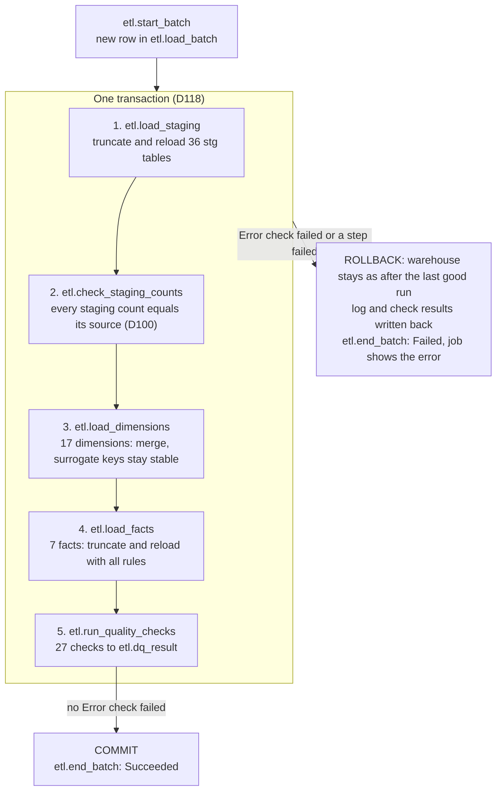
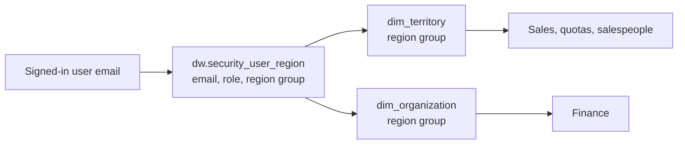

# Architecture

How data moves from the two source databases to the Power BI report, how the load is scheduled
and checked, and how access is controlled.

Decision IDs (D01-D119) refer to [`decision_log.md`](decision_log.md).

---

## 1. Overview

| Layer | Job | Rule |
|---|---|---|
| Sources | The company's operational and finance systems | Never changed (D01) |
| `stg` | Plain copy of only the tables and columns in use | No business rules |
| `dw` | Star schema with all business rules: date shifts, keys, cost rules, currency conversion | One place for logic (D08) |
| `etl` | Log of every load and every data quality check | Every row traceable (D10) |
| Power BI | Friendly names, data types, relationships, DAX measures, security | Light shaping only (D08) |

---

## 2. Load process

One SQL Server Agent job, "EnterpriseBI_DW nightly load", runs one procedure: `etl.run_pipeline`.
Each stage is a stored procedure, so any scheduler (Agent today, Azure Data Factory optionally)
can call the same logic (D09).

| Choice | Decision | Reason |
|---|---|---|
| Facts | Full reload every run (D76) | Largest source table has 121,317 rows; a full reload takes seconds and can never miss updates or deletes. Incremental loading by `ModifiedDate` is the documented next step if volumes grow. |
| Dimensions | Merge (update + insert) (D76) | Surrogate keys stay stable between runs, so keys seen in earlier reports keep their meaning. |
| Failures | All or nothing (D77, D118) | Any failed Error check or step rolls back the whole run, so half-loaded or broken data never reaches the report. The failed run's log and check results are kept. |
| Staging check | Right after the staging load (D100) | A missing or short staging table stops the run before any dimension marks rows as no longer in the source. |
| Schedule | Nightly at 02:00 (D78) | Outside working hours; tables are locked while the run's transaction is open. |

`etl.load_batch` holds one row per run (start, end, status, who started it: `SUSER_SNAME()`, which
is `NT SERVICE\SQLSERVERAGENT` for the job). `etl.load_log` holds one row per step: batch id, step,
start and end time, rows read, rows written, status, error message. A successful run writes 62
steps: 1 staging load per table (36), the staging check, 17 dimensions, 7 facts and the quality
checks.

---

## 3. Data quality checks

Every run writes each check to `etl.dq_result` (batch id, check, value, status). The checks and
their thresholds are rows in `etl.dq_check`, so a threshold changes without changing code (D119).
A failed **Error** rolls the run back (D118); a failed **Warning** is logged as Warn and shown on a
data quality page.

Each check has a rule, because 0 is good for some checks and poor for others:

| Rule | Passes when | Used for |
|---|---|---|
| `at_most` | measured <= expected | Defect counts: lower is better, 0 = none allowed |
| `equals` | measured = expected | Known, documented values: a change in either direction is flagged |
| `at_least` | measured >= expected | Coverage percentages: higher is better |

| Code | Check | Severity | Rule | Expected | Decision |
|---|---|---|---|---|---|
| E01 | Staging row counts that differ from the source (36 tables), checked before any dimension | Error | at_most | 0 | D10, D100 |
| E02 | Facts whose row count differs from what their staging source implies | Error | at_most | 0 | D119 |
| E03 | Fact rows with a required date missing (order, due, start, period) | Error | at_most | 0 | D22, D102, D108 |
| E04 | Fact rows with key -1 (Unknown) where a value must exist | Error | at_most | 0 | D59 |
| E05 | Purchase lines where ordered <> accepted + rejected + short-delivered value | Error | at_most | 0 | D42 |
| E06 | Purchase orders whose allocated freight differs from the header freight | Error | at_most | 0 | D44 |
| E07 | Sales orders whose line totals differ from SubTotal | Error | at_most | 0 | D14 |
| E08 | Sales lines matching more than one cost period | Error | at_most | 0 | D26 |
| E09 | Finance money rows without a USD amount (missing exchange rate) | Error | at_most | 0 | D36 |
| W01 | Lines with a status not seen at design | Warning | at_most | 0 | D28, D104, D111 |
| W02 | Sales lines shipped after their due date | Warning | at_most | 0 | D18 |
| W03 | Purchase lines shipped after a valid due date (invalid due dates are in W07) | Warning | at_most | 0 | D43, D45 |
| W04 | Rows with an optional date empty (unshipped orders, open work orders) | Warning | at_most | 0 | D102, D108 |
| W05 | Sales lines with estimated cost | Warning | equals | 64 | D26 |
| W06 | Sales lines on a discounted offer with no discount | Warning | equals | 2,151 | D66 |
| W07 | Purchase lines with a due date before the order date | Warning | equals | 7 | D45 |
| W08 | Pending or Approved purchase lines already holding received goods | Warning | at_most | 534 | D42 |
| W09 | Quota rows with `territory_source` unknown | Warning | at_most | 0 | D32 |
| W10 | Salespeople with orders but no quota | Warning | at_most | 0 | D32 |
| W11 | Corporate finance rows equal to their children's total | Warning | equals | 342 | D35 |
| W12 | Scrap cost coverage, % of scrapped units with a cost | Warning | at_least | 21.4 | D46 |
| W13 | Stock value coverage, % of stock units with a cost | Warning | at_least | 93.5 | D53 |
| W14 | Sales lines with no cost | Warning | at_most | 0 | D17, D26 |
| W15 | Purchase lines received more than ordered | Warning | at_most | 0 | D42 |
| W16 | Finance rows on units without a region group | Warning | at_most | 0 | D95 |
| W17 | Region groups without a regional manager, or managers of a region that does not exist | Warning | at_most | 0 | D71, D73 |
| W18 | Headcount rows without a pay rate | Warning | at_most | 0 | D55 |

---

## 4. Tools

| Tool | Version | Role |
|---|---|---|
| SQL Server | 2025 Enterprise Developer (17.0.1145.4) | Sources and warehouse |
| SQL Server Agent | Built in, automatic start | Scheduler (pipeline) |
| SQL Server Management Studio | 22 | Development, checks |
| Power BI Desktop | Current Microsoft Store version | Report, model, DAX, security |
| Git and GitHub | Git 2.56 | Version control |
| Azure Data Factory | Optional | Alternative scheduler for the same procedures |

---

## 5. Security

| Role | Sees | Does not see |
|---|---|---|
| Executive | Everything | – |
| Regional Manager | Own region's sales, quotas, salespeople and finance; company-wide inventory | HR facts, `dim_employee_hr`, purchasing, production, unknown (-1) rows |

- One dynamic role reads the user's email and filters `dim_territory` and `dim_organization` by
  the region group in `dw.security_user_region` (D71).
- A user not in the table sees no data (D73).
- Users (D117): four employees from the source, with their source email addresses, tested with
  "View as - Other user" in Power BI Desktop (D74).

| User | Employee | Job title (source) | Role | Region group |
|---|---|---|---|---|
| ken0@adventure-works.com | 1 Ken Sánchez | Chief Executive Officer | Executive | All |
| stephen0@adventure-works.com | 274 Stephen Jiang | North American Sales Manager | Regional Manager | North America |
| syed0@adventure-works.com | 285 Syed Abbas | Pacific Sales Manager | Regional Manager | Pacific |
| amy0@adventure-works.com | 287 Amy Alberts | European Sales Manager | Regional Manager | Europe |

**Security tests (after the build)**

| Test | Pass if |
|---|---|
| Each regional manager's sales total | Equals that region's total seen as Executive |
| Sum of the three regions' sales | Equals the company total minus unknown rows |
| Regional manager on HR pages and `dim_employee_hr` | No rows |
| Europe manager on finance | France and Germany only |
| User not in the mapping table | No data |

Limitation: the .pbix file itself is not protected; row-level security is enforced when content
is shared through the Power BI Service (D74).

---

## 6. Refresh demonstration

The recorded demo shows the full chain working:

1. Report shows current numbers.
2. A test order is added in the source database.
3. The SQL Server Agent job runs.
4. `etl.load_log` and `etl.dq_result` show the new run.
5. Power BI Desktop is refreshed.
6. The report numbers change by the test order's amount.
