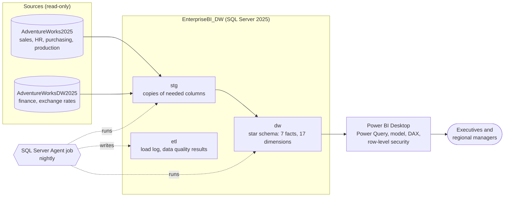
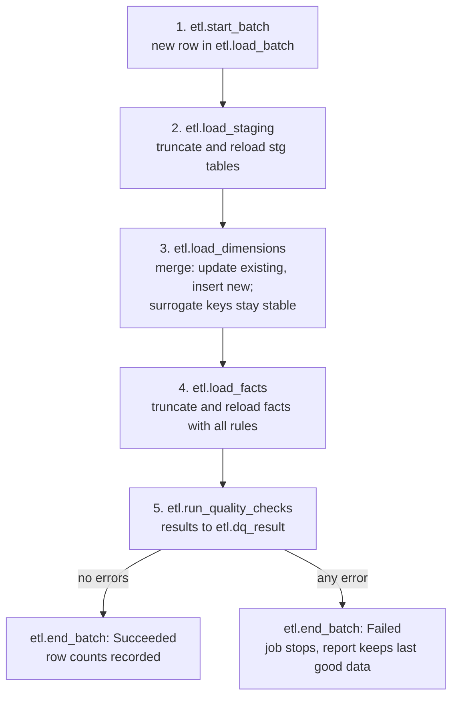
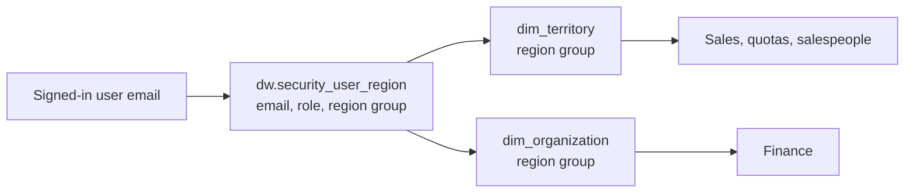

# Architecture

How data moves from the two source databases to the Power BI report, how the load is scheduled
and checked, and how access is controlled.

Decision IDs (D01-D110) refer to [`decision_log.md`](decision_log.md).

---

## 1. Overview

| Layer | Job | Rule |
|---|---|---|
| Sources | The company's operational and finance systems | Never changed (D01) |
| `stg` | Plain copy of only the tables and columns in use | No business rules |
| `dw` | Star schema with all business rules: date shifts, keys, cost rules, currency conversion | One place for logic (D08) |
| `etl` | Log of every load and every data quality check | Every row traceable (D10) |
| Power BI | Friendly names, data types, relationships, DAX measures, security | Light shaping only (D08) |

---

## 2. Load process

One SQL Server Agent job runs five steps. Each step is a stored procedure, so any scheduler
(Agent today, Azure Data Factory optionally) can call the same logic (D09).

| Choice | Decision | Reason |
|---|---|---|
| Facts | Full reload every run (D76) | Largest source table has 121,317 rows; a full reload takes seconds and can never miss updates or deletes. Incremental loading by `ModifiedDate` is the documented next step if volumes grow. |
| Dimensions | Merge (update + insert) (D76) | Surrogate keys stay stable between runs, so keys seen in earlier reports keep their meaning. |
| Failures | Each step logs its result; an error stops the job (D77) | Half-loaded data never reaches the report. |
| Schedule | Nightly at 02:00 (D78) | Outside working hours. |

`etl.load_batch` holds one row per run (start, end, status, who started it). `etl.load_log` holds
one row per step: batch id, step, start and end time, rows read, rows written, status, error message.

---

## 3. Data quality checks

Every run writes each check to `etl.dq_result` (batch id, check, severity, value, status).
**Errors** stop the load; **warnings** are logged and shown on a data quality page (D77).

| Check | Severity | Expected today | Source decision |
|---|---|---|---|
| Staging row counts equal source row counts, checked right after the staging load and before any dimension runs | Error | Equal | D10, D100 |
| Fact rows with a missing date | Error | 0 | D22 |
| Fact rows with key -1 (Unknown) where a value must exist | Error | 0 | D59 |
| Purchase: ordered = accepted + rejected + short-delivered value, per line | Error | 0 failures | D42 |
| Purchase: allocated freight = header freight, per order | Error | 0 failures | D44 |
| Sales: line totals = order SubTotal | Error | 0 failures | D14 |
| Sales: cost lookup finds more than one cost period | Error | 0 | D26 |
| New order status values (sales or purchase) | Warning | 0 | D28 |
| First late shipment (sales) or late vendor delivery | Warning | 0 | D18 |
| Sales lines with estimated cost | Warning | 64 | D26 |
| Lines on a discounted offer with no discount | Warning | 2,151 | D66 |
| Purchase lines with due date before order date | Warning | 7 | D45 |
| Lines on Pending or Approved purchase orders that already hold received goods | Warning | Up to 534 lines | D42 |
| Quota rows with `territory_source` = unknown | Warning | 0 | D32 |
| Salespeople with orders but no quota | Warning | 0 | D32 |
| Corporate finance rows equal to their children's total | Warning | 342 | D35 |
| Scrap cost coverage (% of scrapped units with a cost) | Warning | 21.4% | D46 |
| Stock value coverage (% of stock units with a cost) | Warning | 93.5% | D53 |

---

## 4. Tools

| Tool | Version | Role |
|---|---|---|
| SQL Server | 2025 Enterprise Developer (17.0.1145.4) | Sources and warehouse |
| SQL Server Agent | Built in, automatic start | Scheduler (pipeline) |
| SQL Server Management Studio | 22 | Development, checks |
| Power BI Desktop | Current Microsoft Store version | Report, model, DAX, security |
| Git and GitHub | Git 2.56 | Version control |
| Azure Data Factory | Optional | Alternative scheduler for the same procedures |

---

## 5. Security

| Role | Sees | Does not see |
|---|---|---|
| Executive | Everything | – |
| Regional Manager | Own region's sales, quotas, salespeople and finance; company-wide inventory | HR facts, `dim_employee_hr`, purchasing, production, unknown (-1) rows |

- One dynamic role reads the user's email and filters `dim_territory` and `dim_organization` by
  the region group in `dw.security_user_region` (D71).
- A user not in the table sees no data (D73).
- Demo users: one manager each for North America, Europe and Pacific, tested with
  "View as - Other user" in Power BI Desktop (D74).

**Security tests (after the build)**

| Test | Pass if |
|---|---|
| Each regional manager's sales total | Equals that region's total seen as Executive |
| Sum of the three regions' sales | Equals the company total minus unknown rows |
| Regional manager on HR pages and `dim_employee_hr` | No rows |
| Europe manager on finance | France and Germany only |
| User not in the mapping table | No data |

Limitation: the .pbix file itself is not protected; row-level security is enforced when content
is shared through the Power BI Service (D74).

---

## 6. Refresh demonstration

The recorded demo shows the full chain working:

1. Report shows current numbers.
2. A test order is added in the source database.
3. The SQL Server Agent job runs.
4. `etl.load_log` and `etl.dq_result` show the new run.
5. Power BI Desktop is refreshed.
6. The report numbers change by the test order's amount.
