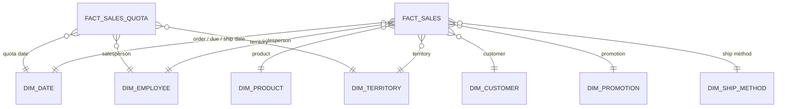
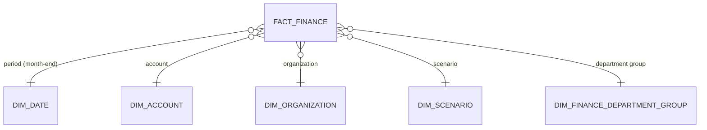
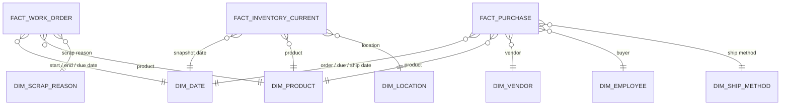
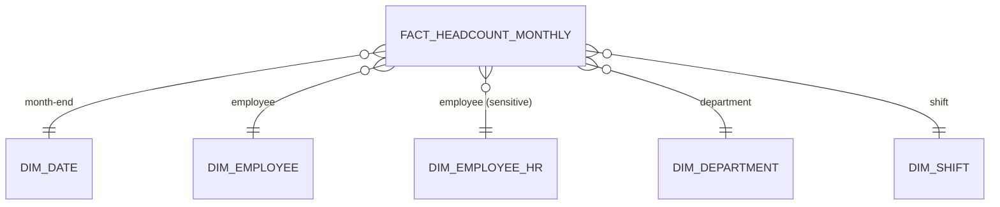

# Data Model

The warehouse `EnterpriseBI_DW` holds a **fact constellation**: 7 fact tables that share
17 dimensions. Shared (conformed) dimensions such as date, product and employee let the four
modules (sales, finance, HR, supply chain) be analysed together.

Decision IDs (D01-D113) refer to [`decision_log.md`](decision_log.md).

---

## 1. Conventions

| Rule | Detail | Decision |
|---|---|---|
| Keys | Facts link to dimensions through surrogate keys (`<name>_key`). The source ID is kept as `<name>_id`. | D12, D59 |
| Special keys | `-1` = Unknown (data missing). `-2` = Not applicable (no value can exist). Keys are never NULL, except `manager_key` (hierarchy root, D90), `ship_date_key` (order not yet shipped, D102) and `end_date_key` (work order still open, D108). | D17, D59, D90, D102, D108 |
| Unknown measures | NULL, never 0. A real zero means "known to be zero". | D17 |
| Audit columns | Every fact has `batch_id` (link to `etl.load_log`) and `loaded_at`. | D10 |
| Dates | `date_key` is a yyyymmdd number (e.g. 20250629). HR dates +4,017 days, DW dates +4,170 days. | D19-D21 |
| Currency | All reported money is USD. Finance keeps the local amount as well. | D36 |
| History | Dimensions are Type 1 (current values). History that matters (cost, department, pay) is stored in the facts. | D60, D55 |

---

## 2. Bus matrix

Which fact uses which dimension.

| Dimension | sales | sales_quota | finance | purchase | work_order | inventory_current | headcount_monthly |
|---|:---:|:---:|:---:|:---:|:---:|:---:|:---:|
| dim_date | x | x | x | x | x | x | x |
| dim_product | x | | | x | x | x | |
| dim_employee | x (salesperson) | x (salesperson) | | x (buyer) | | | x |
| dim_employee_hr | | | | | | | x |
| dim_territory | x | x | | | | | |
| dim_customer | x | | | | | | |
| dim_promotion | x | | | | | | |
| dim_ship_method | x | | | x | | | |
| dim_vendor | | | | x | | | |
| dim_location | | | | | | x | |
| dim_scrap_reason | | | | | x | | |
| dim_department | | | | | | | x |
| dim_shift | | | | | | | x |
| dim_account | | | x | | | | |
| dim_organization | | | x | | | | |
| dim_scenario | | | x | | | | |
| dim_finance_department_group | | | x | | | | |

`dim_date` plays several roles (order, due, ship, start, end, snapshot dates). In Power BI one
relationship per fact is active; the others are used through `USERELATIONSHIP` in measures.

---

## 3. Diagrams

### Sales

### Finance

### Supply chain

### HR

`dim_employee` and `dim_employee_hr` are not linked to each other directly, to avoid two filter
paths between the same tables.

---

## 4. Fact tables

### 4.1 fact_sales

**Answers:** S1-S4, S6-S9, P8, P9. **Grain:** one row per sales order line.
**Source:** `Sales.SalesOrderDetail` + `Sales.SalesOrderHeader`, cost from `Production.ProductCostHistory`.

| Column | Meaning |
|---|---|
| `order_date_key`, `due_date_key`, `ship_date_key` | Dates (order date is the main one); `ship_date_key` is empty for an order not yet shipped (D102) |
| `product_key`, `customer_key`, `territory_key`, `promotion_key`, `ship_method_key` | Dimension links |
| `salesperson_key` | Employee; `-2` (Not applicable) for online orders |
| `sales_order_id`, `sales_order_line_id`, `sales_order_number` | Trace back to the source |
| `channel` | Online / Reseller |
| `order_status` | Source status text, as the source function returns it (D104; all Shipped today) |
| `order_qty`, `unit_price`, `discount_pct` | From the line |
| `gross_amount` | Unit price x quantity, before discount |
| `discount_amount` | Gross amount - line total |
| `line_total` | Revenue for the line, 6 decimals as in the source (D105) |
| `unit_cost` | Cost valid on the order date |
| `cost_amount`, `gross_margin` | Unit cost x quantity; line total - cost amount |
| `is_cost_estimated` | 1 for the 64 lines sold after their cost history ended |

**Rules:** revenue excludes Rejected and Cancelled orders (D14, D28); cost rule D26; margin %,
days to ship and on-time % are DAX measures (D18, D29).

### 4.2 fact_sales_quota

**Answers:** S5, S9. **Grain:** one row per salesperson per quota period.
**Source:** `Sales.SalesPersonQuotaHistory`, `Sales.SalesTerritoryHistory`.

| Column | Meaning |
|---|---|
| `quota_date_key` | Start of the quota period |
| `salesperson_key`, `territory_key` | Links; managers use a region-level territory row |
| `quota_period_start`, `quota_period_end` | Period covered (3 months, D30) |
| `sales_quota` | Target amount |
| `territory_source` | history / nearest_history / region_from_orders / unknown (D32, D109) |

**Rule:** actual vs quota is compared by quota period, not calendar quarter (D31).

### 4.3 fact_finance

**Answers:** F1-F8. **Grain:** one row per month x organisation x department group x account x
scenario x entry type. **Source:** `AdventureWorksDW2025.dbo.FactFinance`, rates from `FactCurrencyRate`.

| Column | Meaning |
|---|---|
| `period_date_key` | Month-end of the shifted date (D33) |
| `organization_key`, `finance_department_group_key`, `account_key`, `scenario_key` | Links |
| `entry_type` | Regular / Year-end adjustment (D34) |
| `currency_code`, `amount_local`, `exchange_rate`, `amount_usd` | Local amount and USD conversion (D36) |
| `source_date` | Original DW date |

**Rules:** Corporate's own rows link to "Corporate (direct)" (D35); profit lines use
`dim_account.sign_to_net_income` (D38); balance sheet uses the closing balance of the last month
with balance sheet rows (D39); statistical accounts are never added to money; finance and sales
are never combined in one KPI (D40).

### 4.4 fact_purchase

**Answers:** P1-P3, P8. **Grain:** one row per purchase order line.
**Source:** `Purchasing.PurchaseOrderDetail` + `PurchaseOrderHeader`, lead time from `ProductVendor`.

| Column | Meaning |
|---|---|
| `order_date_key`, `due_date_key`, `ship_date_key` | Dates |
| `product_key`, `vendor_key`, `buyer_key`, `ship_method_key` | Links |
| `purchase_order_id`, `purchase_order_line_id`, `po_status` | Trace and status; status text as the source function returns it (D111) |
| `order_qty`, `received_qty`, `rejected_qty`, `stocked_qty` | Quantities |
| `unit_price` | Order price |
| `ordered_value`, `accepted_value`, `rejected_value`, `short_delivered_value` | Ordered = accepted + rejected + short-delivered (D42) |
| `freight_allocated` | Order freight split by value, exact (D44, D111) |
| `promised_lead_days` | Vendor's average lead time (current value) |
| `is_due_date_invalid` | 1 when the due date is before the order date (D45) |

### 4.5 fact_work_order

**Answers:** P6, P7. **Grain:** one row per work order. **Source:** `Production.WorkOrder`.

| Column | Meaning |
|---|---|
| `start_date_key`, `end_date_key`, `due_date_key` | Dates; `end_date_key` is empty for an open work order (D108) |
| `product_key`, `scrap_reason_key` | Links; `-2` "No scrap" when nothing was scrapped |
| `work_order_id` | Trace |
| `order_qty`, `stocked_qty`, `scrapped_qty` | Quantities (stocked + scrapped = ordered) |
| `days_to_finish`, `days_late`, `is_finished_late` | Timing; `days_late` is 0 when on time (D108) |
| `unit_cost`, `scrap_cost`, `cost_source` | Cost rule D110; scrap cost hidden while coverage is low and always shown with its coverage (D46) |

### 4.6 fact_inventory_current

**Answers:** P4, P8, P9. **Grain:** one row per product per location, as of the latest source
date, plus one zero row per active product without stock (D52). **Source:** `Production.ProductInventory`.
The table is replaced on every load.

| Column | Meaning |
|---|---|
| `snapshot_date_key` | Latest source date (11 Aug 2025 today) |
| `product_key`, `location_key` | Links; `location_key` = "No stock location" for zero rows |
| `quantity` | Units at the location |
| `unit_cost`, `stock_value`, `cost_source` | Standard cost, else last purchase price, else NULL (D53); `stock_value` is 0 at zero quantity (D112) |
| `last_modified_date` | When the source row last changed |
| `is_zero_stock_row` | 1 for the added zero rows |

**Rules:** semi-additive (never summed over dates); stock status uses the inventory position
(D51); available stock = storage locations (D50).

### 4.7 fact_headcount_monthly

**Answers:** H1-H5, revenue per employee. **Grain:** one row per employee per month-end, from the
(shifted) hire date, April 2022 to October 2025 (D58; window derived as in D113). **Source:** `HumanResources.Employee`,
`EmployeeDepartmentHistory`, `EmployeePayHistory`.

| Column | Meaning |
|---|---|
| `month_end_date_key` | Month-end |
| `employee_key`, `department_key`, `shift_key` | Links, department and shift as of the month-end (D55) |
| `pay_rate`, `pay_frequency` | Hourly rate as of the month-end (D56) |
| `age_at_month_end`, `tenure_months` | Derived; birth date itself is not stored (D62); tenure in calendar months from the hire month (D113) |
| `is_hired_this_month` | 1 in the month of hire |

**Rules:** semi-additive, average headcount for ratios (D57); average pay follows complementary
suppression (D64).

---

## 5. Dimensions

| Dimension | Source | Main columns | Special rows |
|---|---|---|---|
| `dim_date` | Generated, 2017-01-01 to 2025-12-31 | `date_key`, `full_date`, day, week, month, `year_month`, quarter, year, `month_end_date`, fiscal year (from 1 July), fiscal quarter, `quota_period_start`, `quota_period_end`, `quota_period_label` | None (D22) |
| `dim_product` | `Production.Product` + subcategory + category | name, number, colour, size, product line, class, style (words, "N/A" if missing), subcategory, category ("Internal parts" for parts), finished good and made-in-house flags, safety stock, reorder point, standard cost and list price (NULL if 0), sell start and end, status | -1 |
| `dim_employee` | `HumanResources.Employee` + `Person.Person` | name, job title, organization level, `manager_key`, current department and shift, `is_salesperson`, `is_buyer` | -1, -2 "No salesperson" |
| `dim_employee_hr` | Same, sensitive part | age band, gender, salaried flag, hire date, vacation and sick leave hours | -1 |
| `dim_territory` | `Sales.SalesTerritory` + country | territory, country code and name, region group, `is_region_level` | -1, 3 region-level rows |
| `dim_customer` | `Sales.Customer` + `Sales.Store` | account number, customer type, label (no personal names), `has_orders`, home territory, home region group | -1 |
| `dim_promotion` | `Sales.SpecialOffer` | name, type, category, offer discount %, start, end, `was_used` | -1 |
| `dim_ship_method` | `Purchasing.ShipMethod` | name, base charge, rate | -1 |
| `dim_vendor` | `Purchasing.Vendor` | name, credit rating (words), preferred, active | -1 |
| `dim_location` | `Production.Location` | name, `location_type` (Storage / Work centre), cost rate, availability | -1, -2 "No stock location" |
| `dim_scrap_reason` | `Production.ScrapReason` | reason | -1, -2 "No scrap" |
| `dim_department` | `HumanResources.Department` | department, department group | -1 |
| `dim_shift` | `HumanResources.Shift` | name, start time, end time | -1 |
| `dim_account` | DW `DimAccount` | code, name, account type, operator, value type, statement, `sign_to_net_income`, levels 1-6, sort order (D96), `is_leaf` | -1 |
| `dim_organization` | DW `DimOrganization` + `DimCurrency` | name, levels 1-3, region group (D95), mapped territory through `etl.org_territory_map` (D94), currency code, `is_leaf` | -1 |
| `dim_scenario` | DW `DimScenario` | Actual, Budget, Forecast | -1 |
| `dim_finance_department_group` | DW `DimDepartmentGroup` | level 1 "Corporate", level 2 group, `is_corporate_direct` (Corporate's own source row is shown as level 2 "Corporate (direct)") | -1 |

**Security table** `dw.security_user_region` (user email, role, region group) is not a dimension;
it drives row-level security through `dim_territory` and `dim_organization` (D71-D73).

---

## 6. Main KPI definitions

| Module | KPI | Definition |
|---|---|---|
| Sales | Revenue | Sum of `line_total`, excluding Rejected and Cancelled orders |
| Sales | Gross margin % | Sum of gross margin / revenue |
| Sales | Quota attainment % | Revenue in the quota period / sales quota |
| Sales | Customers | Distinct customers with orders in the period |
| Finance | Net sales, gross margin, operating profit, net income | Sum of `amount_usd` x `sign_to_net_income` under each line |
| Finance | Budget variance | Actual - Budget (budget exists May 2022 - Apr 2023 only) |
| Finance | Current ratio | Closing current assets / closing current liabilities |
| Supply chain | Spend | Sum of `accepted_value` |
| Supply chain | OTIF % | Lines on time, in full, with no rejects / lines (due and valid only) |
| Supply chain | Unit fill rate | Received qty / ordered qty |
| Supply chain | Rejection % | Rejected qty / received qty |
| Supply chain | Scrap rate | Scrapped qty / ordered qty (work orders) |
| Supply chain | On-time production % | Work orders finished by due date / work orders |
| Supply chain | Stock value | Sum of `stock_value` (with coverage shown) |
| HR | Headcount | Employees at the last month-end of the selection |
| HR | Average pay rate | Average `pay_rate`, with complementary suppression |
| Executive | Revenue per employee | Revenue / average headcount of the period |

All YTD, YoY and rolling measures use each module's own last data date (D24).
